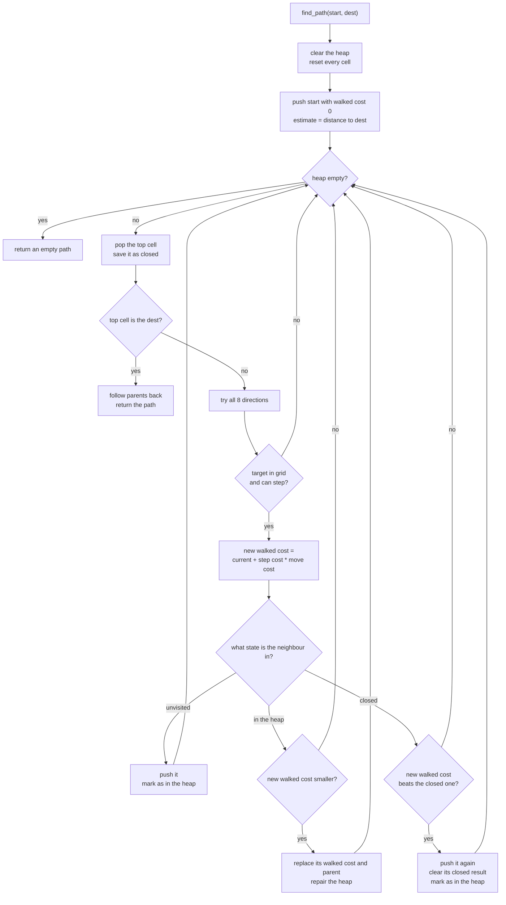

## 前言

上一篇把网格的坐标换算捋顺了，也留了个尾巴：格子还不会说自己通不通过，A* 也还没影。
这一篇我们就把寻路补上。

上篇说过，Godot 自带 `AStarGrid2D`，为什么还要自己写？
博主当时的理由是不想迁就别人的坐标系。
真写起来才发现，这个理由只是一半。

肉鸽里的寻路跟一般游戏不太一样。
一次寻路的结果要拿来驱动回合移动，敌人一多，每回合都要算很多条路径。
地形也不只是「通」和「不通」，同样一格，能走和走起来费劲是两回事。
这些需求凑在一起，用现成的组件不是不行，但总会在某个地方别扭一下。

所以博主干脆自己搭一套。
骨架还是教科书里那个 A*，`g` 是已经走过的代价，`h` 是到终点的估计，每次挑 `g + h` 最小的格子往外扩。
算法本身没什么好讲的，真正花时间的在数据结构上：怎么找最小、怎么改代价、怎么记状态。
这篇就按这个顺序讲，中间用几张图把流程串起来。

代价也说在前面。
自己写意味着每个细节都要自己想，邻接关系、对角穿墙、状态复位，漏一个就是半天调试。
而且现在这套只覆盖了单起点单终点，还没有做多目标或者流场寻路，敌人一多大概还得再改。

好了，闲言少叙，让我们开始吧！

## 先把网格补全

寻路要知道哪些格子能站人、走过去要花多少代价，这些得让格子自己带着。

```text
cell:
    index
    world_position
    move_cost      # 踏进这格要付的代价，默认 1
    walkable       # 能不能站人
```

通不通由 `can_be_walked` 表示，踏进这格的代价是 `move_cost`，默认都是 1。
以后想加沼泽、碎石这类地形，改 `move_cost` 就行，算法那边不用动。

**提醒**：`move_cost` 记在「目标格」上，所以从一个高代价的格子离开并不会再付一次钱。
博主觉得这样更好理解，但如果以后想做「移动力」这类机制，记得这个约定。

邻接关系也放在网格里，A* 只管问「某一格往某个方向再走一步是哪一格」。

```text
function neighbor_of(cell, direction)
    step = offset_of(direction)
    target = cell + step

    if out_of_grid(target)
        return none

    return index_of(target)
```

方向固定成八个，每个方向对应一对行列偏移。
越界统一返回「没有邻格」，调用方配一次有效性判断就够了，不用每个分支各自挡一遍。

还有一个坑是对角线穿墙。
如果左上角的格子是通的，正上方是墙，那从当前格往左上走，视觉上就是贴着墙角穿过去，很难看。
所以对角方向会额外查一下两个正方向的格子。

```text
function can_step(cell, direction)
    if not walkable(cell)
        return false

    if diagonal(direction)
        # 两侧都能走才放行，否则会贴着墙角斜穿过去
        return walkable(cell + horizontal(direction))
           and walkable(cell + vertical(direction))

    return walkable(cell + direction)
```

这一步不是 A* 的一部分，而是网格的规矩。
先把它定死，后面算代价的时候就不用反复纠结。

## 为什么先换掉容器

按最直白的写法，用数组存所有待访问的格子，每轮从头扫一遍找 `g + h` 最小的那个。
思路是对的，问题在规模。
格子总数是 `N`，每轮扫描是 `O(N)`，整次寻路很容易退化到 `O(N²)`。
十乘十的网格看不出来，放大到八十一百乘一百，每回合给一堆敌人各算一条路径，卡顿就来了。

换成最小堆之后，取最小和插入都降到 `O(log N)`。
但光有堆还不够，A* 还得做两件别的事。

一是改代价。
用动态数组加哈希表的常见写法，在堆里找某个格子是线性查找，前面省下来的又被吃回去了。

二是判断状态。
一个格子可能没被访问过，可能还在堆里，也可能已经出堆定案了。
状态如果拿哈希表去存，哈希开销又是一笔。

博主的做法是让网格下标直接当数组下标，所有状态都摊在几个扁平数组里。
下标即身份，访问即索引，A* 里最频繁的几下几乎都是常数时间。

## 堆里都装了什么

先看堆。

```text
heap:
    cells_by_slot          # 每个堆位置坐着哪个格子
    walked_cost_by_slot
    estimate_by_slot
    parent_by_slot
    slot_of_cell           # 反查：格子当前在哪个堆位置
```

这四份数据都是按「堆位置」来平行摆放的。
「这个位置上坐着哪个格子」是核心，其余三份是那个格子的 `g`、`h` 和父节点。
所以一次交换要同时动四处，写的时候得看清楚哪个按堆位置数、哪个按格子下标数。

反查表方向是反的，按格子下标存堆位置。

```text
function swap(heap, slot_a, slot_b)
    swap(heap.cells_by_slot[slot_a], heap.cells_by_slot[slot_b])
    swap(heap.walked_cost_by_slot[slot_a], heap.walked_cost_by_slot[slot_b])
    swap(heap.estimate_by_slot[slot_a], heap.estimate_by_slot[slot_b])
    swap(heap.parent_by_slot[slot_a], heap.parent_by_slot[slot_b])

    heap.slot_of_cell[heap.cells_by_slot[slot_a]] = slot_a      # 反查表跟着改
    heap.slot_of_cell[heap.cells_by_slot[slot_b]] = slot_b
```

有了反查表，「某个格子现在在堆的哪个位置」就是一次查表，改 `g` 或者换父节点再把堆修一遍都很直接。

```text
function set_walked_cost(heap, cell, new_cost)
    slot = heap.slot_of_cell[cell]
    heap.walked_cost_by_slot[slot] = new_cost

function repair(heap, cell)
    slot = heap.slot_of_cell[cell]
    bubble_up(heap, slot)
    bubble_down(heap, slot)
```

代价变小的格子只会往下沉，理论上只要往上冒一遍。
两边都跑一遍是博主图省事，多一次 `O(log N)` 换不用记方向，目前这个量级不值当优化。

**提醒**：反查表必须和堆保持同步，压入、弹出、交换三处都要维护。
漏掉一处，反查出来的位置就是错的，表现是某条路径突然绕了远路，很难往堆上想。

## 堆的排序靠什么

比较的依据只有一个：`g + h`。

```text
function bubble_down(heap, slot)
    loop
        child = left_child(slot)
        right = right_child(slot)

        if right exists and total(heap, right) < total(heap, child)
            child = right
        if child does not exist or total(heap, child) >= total(heap, slot)
            break

        swap(heap, slot, child)
        slot = child

function total(heap, slot)
    return heap.walked_cost_by_slot[slot] + heap.estimate_by_slot[slot]      # 不单独存，比较时现算
```

每次比较都临时加起来，没有单独存一份总和。
少一个数组就少一份同步，代价是每次比较多做一次加法，博主觉得这笔账划算。

`h` 用的是格子之间的直线距离。

```text
function distance(a, b)
    dx = column_of(a) - column_of(b)
    dy = row_of(a) - row_of(b)
    return sqrt(dx * dx + dy * dy)
```

**提醒**：启发函数不能高估真实代价，否则可能错过最优路径。
现在步进代价最小是 1，对角是 `1.4142` 左右，直线距离刚好贴着下界。
所以对角代价博主老老实实手写常数，没用 `sqrt(2)`。假设哪天改用 `1.0` 做对角，`h` 就开始高估了。

## 状态怎么记

三个扁平数组加一个字节数组，覆盖了 A* 需要记住的全部信息。

```text
result:                     # 格子出堆后留下的最终结果
    walked_cost[cell]
    estimate[cell]
    parent[cell]

state[cell]:
    0 = unvisited
    1 = in heap
    2 = closed
```

这一块存的是「格子出堆定案之后」的最终结果，名字里的 `closed` 和状态里的 2 是同一个意思。
堆里的那份数据在弹出之后会被丢掉，所以得有一份长期存档，最后回溯路径用的就是这里的父节点。

状态用很小的整数存 0、1、2，是特意选的小类型。
格子再多，这一份也只有几 KB 的占用，而且是连续内存，遍历的时候缓存友好。

复用同一个实例连续寻路时，旧数据必须清干净，所以初始化单独抽了出来。

```text
function reset()
    for each cell
        result.walked_cost[cell] = infinity
        result.estimate[cell] = infinity
        result.parent[cell] = none
        state[cell] = unvisited
```

```text
unvisited             in heap              closed
   0      ──push──>     1      ──pop──>     2
```

被 closed 改回 in heap 的那条边，图上没有画，它只在发现更短路径时出现。

出堆之后又发现更短的路径，就得把它从 2 改回 1，重新塞回堆里。
这在一般图里不常见，带权地形下却是会发生的。

## 主循环长什么样

下面这张图把一次寻路的流程串起来。



整个循环里没有「找到终点再回头算」，终点一弹出就直接定案。
这是 A* 的性质：堆顶的 `g + h` 最小，`h` 又不高估，那它出堆时的 `g` 就是最短的。

步长在循环里按方向定。

```text
function step_cost(direction)
    if diagonal(direction)
        return 1.4142      # 对角，sqrt(2) 的手写近似

    return 1
```

这里把方向和固定的排列顺序绑在了一起，看着省事，但以后要是有人调换方向的排列顺序，这段就会悄悄出错。
**提醒**：方向的排列顺序也算是算法的一部分，别随便改。

## 三种状态各自的处理

出堆之后的第一件事，是把堆顶那份数据落到 closed 存档里。

```text
function close_top(heap)
    cell = heap.cells_by_slot[0]
    result.walked_cost[cell] = heap.walked_cost_by_slot[0]
    result.estimate[cell] = heap.estimate_by_slot[0]
    result.parent[cell] = heap.parent_by_slot[0]
    state[cell] = closed
    pop(heap)      # 先读再弹，顺序反了就取不到
    return cell
```

先读再弹，顺序反了就拿不到数据。

接下来遍历八个邻居，按邻居当前的状态分三路。
未访问过的，直接进堆。

```text
function relax_unvisited(heap, neighbor, new_cost, current)
    push(heap, neighbor, new_cost, distance(neighbor, destination), current)
    state[neighbor] = in_heap
```

已经在堆里的，比一下新代价是不是更小，小了就改，再修堆。

```text
function relax_in_heap(heap, neighbor, new_cost, current)
    if new_cost < walked_cost_of(heap, neighbor)
        set_walked_cost(heap, neighbor, new_cost)
        set_parent(heap, neighbor, current)
        repair(heap, neighbor)
```

已定案的，多一道比较，过了才把它从 closed 请回堆里。

```text
function relax_closed(heap, neighbor, new_cost, current)
    if new_cost < result.walked_cost[neighbor]
        push(heap, neighbor, new_cost, result.estimate[neighbor], current)
        result.walked_cost[neighbor] = infinity
        result.estimate[neighbor] = infinity
        result.parent[neighbor] = none
        state[neighbor] = in_heap
```

这一路是三个阶段里最长的，也最容易被忽略。
它对 `h` 的估计有要求：`h` 一旦高估，就已经定案的格子也可能被找到更短的路径，A* 会开始重复劳动。

重新进堆的时候要带上它原来的估计代价，这一份看起来有点多余，其实不能省。
格子回到堆里之后，原来的估计值就只剩 closed 存档里这一份了，传 0 的话排序整个就乱了。

## 回溯与收尾

堆顶弹出终点的时候就停下，然后从终点的父节点一路往回走。

```text
function build_path(destination)
    path = empty list
    parent = result.parent[destination]

    while parent != none
        prepend parent to path
        parent = result.parent[parent]

    return path
```

注意起点没被加进路径，它是父节点链的尽头。
调用方如果需要完整路径，自己把起点拼回去。

还有起点就是终点的情况。
这时候堆里只有一个格子，第一次弹出就命中了 `dest`，父节点是 -1，返回空数组。
空数组和「找不到路」的返回值一样，**提醒**：调用方要能接受这两种情况都当成「不用走」。

## 放到网格里看

光看代码有点干，博主在项目里画了一块测试地形来验证，就是这个样子。


灰色是普通格子，黑色是墙，红点是起点，红叉是终点，绿色箭头是算出来的路径。

把坐标对一下。
网格是 10 列 15 行，起点 `50` 落在第 3 列第 5 行，终点 `130` 落在第 8 列第 10 行。
中间那段墙从第 4 列第 6 行一路竖下来，到第 8 行再往右折，右边还有一列竖墙。
一条路被折成了倒扣的 U 形。

路径先贴着左墙往下走到底，再从缺口横过去，最后爬到终点身边。
中途的转弯都是对角，而且都发生在贴墙角的位置。

这些细节恰好能验证前面那几条规则。

对角穿墙的检查在起作用。
绿色箭头的对角段都跳过了墙角那一格，没有直接斜穿过去。
代价的累加也是的，横向走过的步数和斜向走过的步数不一样，路径没有为了少走几步去硬凑更多对角。博主手算过一遍，这条路径的总代价是最小的。

**提醒**：这套路径是从墙的左边绕下去的，如果两边的代价一样，最后选哪边取决于邻居的遍历顺序。
不需要纠结，能让调试画出来的和算法算出来的对得上就行。

画图这部分没写进寻路里，是调试绘制器多长出来的功能。
`draw_path` 收到路径之后，把起点画成圆、终点画成叉，中间的每一段画成箭头。
坐标换算复用上一篇那套写法，所以不管相机怎么挪，箭头都贴在格子上。

## 尾声

这一篇的流程其实没离开过课本，`g`、`h`、open 表、closed 表都在。
博主想说的重点在数据结构上。

把网格下标直接当数组下标用，是一开始就定下的方向。
有了这个约定，堆里不需要 `Dictionary`，closed 存档不需要哈希，状态判断也只是一次数组读取。
代码看起来比教科书版本啰嗦，多了一堆平行数组和反查表，但换来的是每一步都可控。

目前还有几件事没做。
多目标寻路的思路大概是反着来，从目标反向做一次，把每个格子的距离铺开，也就是流场。
再就是 `cost` 目前是静态的，如果想让单位互相阻挡，需要在寻路时按上下文临时改一下 `valid`，这一块还没想好怎么接。

各位如果也想自己写一份 A*，博主建议先别急着关注算法本身，算法书上都有。
先把邻接关系、状态复位、堆的同步这三件事理清楚，剩下的基本是填空题😉
